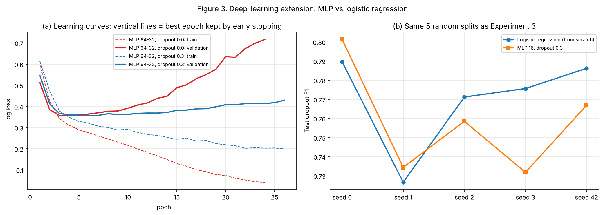

# Deep-Learning Extension: Does an MLP Beat Logistic Regression?

*Follow-up to the FIT1061 H2 project. Yuan Yuxuan.*

## Question

[REPORT.md](REPORT.md) (section 4, "Linearity") notes that logistic regression cannot model
interactions between features, such as age × evening attendance. A multi-layer perceptron (MLP)
can. This extension tests whether that limitation actually costs performance on this problem.

## Method

Everything except the model is reused unchanged: the leakage-free features, the stratified
60/20/20 split, the `Preprocessor` (102 inputs), the validation-tuned threshold (best F1 with
recall ≥ 0.70) and the dropout-class metrics. The test set is used once.

- **Architecture** (`early_warning/mlp.py`): `[Linear → ReLU → Dropout] × k → Linear`, written
  as a PyTorch `nn.Module`. The architecture is separate from the training code, so the same
  `train_model` function trains every model.
- **Training:** mini-batch Adam (lr 0.001, batch 64), weight decay 1e-4 (L2), binary
  cross-entropy, and early stopping on validation log loss (patience 20, best epoch restored).
- **Selection:** six architectures (1–2 hidden layers, 16–128 units, dropout 0–0.5), chosen by
  validation log loss, which is the same rule Experiment 1 used for logistic regression.
- **Control:** the same logistic regression written in PyTorch (`TorchLogReg`). It matches the
  from-scratch model (probability correlation 0.999), so the training code is not the cause of
  any difference.

## Results

Selected architecture: **one hidden layer of 16 units, dropout 0.3** (1,665 parameters, against
103 for logistic regression).

| Test set | LogReg (from scratch) | MLP 16, dropout 0.3 |
|---|---|---|
| Recall | 0.764 | 0.817 |
| F1 | **0.786** | 0.767 |
| ROC AUC | 0.906 | 0.908 |
| Precision@100 | 0.99 | 0.99 |
| Hidden dropouts caught | 51.3% | 58.8% |
| Recall, scholarship holders | 0.517 | 0.517 |

Across the same 5 random splits as Experiment 3:

| Mean ± std | LogReg | MLP | MLP better on |
|---|---|---|---|
| F1 | **0.770 ± 0.025** | 0.759 ± 0.028 | 2/5 |
| AUC | 0.901 ± 0.011 | 0.901 ± 0.011 | 3/5 |
| Precision@100 | **0.968 ± 0.023** | 0.962 ± 0.023 | 0/5 |



## Findings

1. **The MLP does not beat logistic regression.** The ranking quality (AUC) is identical, and
   F1 and precision@100 are slightly lower on average. The extra recall on the main split comes
   from a lower validation-tuned threshold (0.30 vs 0.41), not from better ranking: the PyTorch
   logistic regression shows the same shift.
2. **Overfitting is the main obstacle.** With 2,654 training students, every MLP reaches its best
   validation loss within 3–12 epochs. Without dropout (Figure 3a, red), training loss falls
   towards 0.05 while validation loss climbs from 0.36 to 0.72. Dropout slows this down but
   does not stop it, and early stopping is essential.
3. **The fairness gap is a data problem, not a model-capacity problem.** Recall for scholarship
   holders stays at 0.517 under every model. This supports the conclusion in REPORT.md: these
   students look academically successful at the end of semester 1, and a more flexible model
   cannot find a signal that is not in the features.
4. **Logistic regression remains the right choice here.** It performs as well, has 16× fewer
   parameters, trains deterministically, and every weight can be shown to the advisor. The
   interactions the MLP could learn do not carry enough extra signal in this dataset.

## Summary: logistic regression vs MLP

| | Logistic regression (FIT1061) | MLP (PyTorch) |
|---|---|---|
| Architecture | Input → output directly | Input → hidden layer (16 neurons, ReLU) → output |
| Number of weights | 103 | 1,665 |
| Can learn feature combinations? | No, only a weighted sum | Yes, e.g. "low grades AND older" |
| Starting weights | All 0 | Small random numbers |
| Gradients | Derived by hand: Xᵀ(p − y)/n | Computed by autograd: `loss.backward()` |
| Update rule | Plain gradient descent: w −= lr × grad | Adam: an adaptive step per weight |
| Data per update | All 2,654 students at once (full batch) | Mini-batches of 64 students |
| Stops when | Loss stops changing (converged) | Early stopping: validation stops improving |
| Overfitting control | L2 regularisation | L2 (weight decay) + dropout + early stopping |
| Same result every run? | Yes (convex: one best answer) | Depends on the random seed (non-convex) |
| Explainable to the advisor? | Yes, each weight has a clear meaning | Hard, because hidden neurons mix features |
| Test F1 (average of 5 splits) | **0.770** | 0.759 |

## How to run

Needs PyTorch in addition to the original requirements (see `requirements-mlp.txt`).

```bash
python run_mlp.py                 # about 20 s on CPU, saves figures/figure3_mlp_vs_logreg.png
python run_mlp.py --device cuda   # GPU (usually no faster here: the data are small)
python -m pytest                  # original tests + tests/test_mlp.py
```

| New file | Contents |
|---|---|
| `early_warning/mlp.py` | `TorchLogReg` and `MLP` architectures, `train_model` (Adam + early stopping), `predict_proba` |
| `early_warning/experiment4.py` | Architecture selection, test comparison, 5-split robustness, Figure 3 |
| `run_mlp.py` | Runs Experiment 4 |
| `tests/test_mlp.py` | Output shapes, agreement with the from-scratch model, early stopping, reproducibility |
