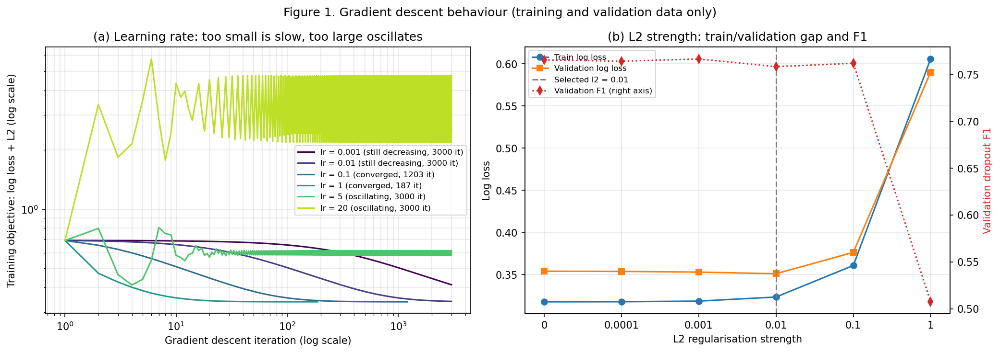
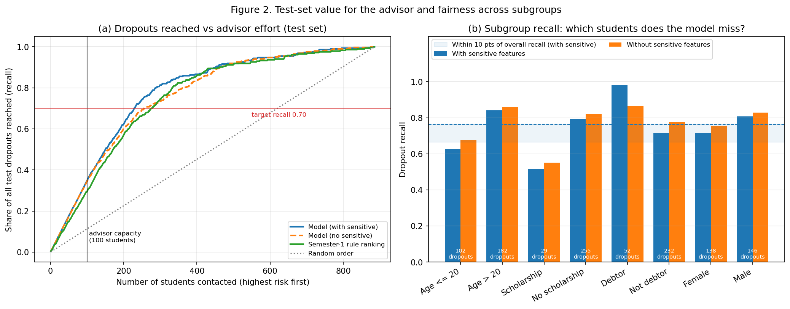

# Student Dropout Early Warning

FIT1061 Introduction to Artificial Intelligence, HD Task H2. Yuan Yuxuan.

About 32% of the 4,424 students in the dataset dropped out. At the end of semester 1, a
first-year academic advisor who has time to contact roughly 100 students must decide whom to
contact first. This program ranks students by estimated dropout risk using **only information
available at that point**, so there is still time to help before semester 2, and shows the
advisor the three features that raised each student's risk.

The model is **logistic regression implemented from scratch** (numerically stable sigmoid, log
loss with L2 regularisation, full-batch gradient descent), with the decision threshold tuned on
validation data to favour recall. It is verified against scikit-learn and compared with a
majority-class baseline and a semester-1 rule (flag students who passed fewer than half of their
enrolled units). The full write-up is in [REPORT.md](REPORT.md).

## Results (test set)

| | Recall | F1 | Precision@100 |
|---|---|---|---|
| Majority class | 0.000 | 0.000 | n/a |
| Semester-1 rule | 0.581 | 0.678 | 0.84 |
| **Logistic regression (t = 0.41)** | **0.764** | **0.786** | **0.99** |

- 100% agreement with scikit-learn's `LogisticRegression` on test predictions.
- Of the 119 "hidden" dropouts who passed at least half their units, the rule catches none and
  the model catches 51.3%.
- Across five random splits, F1 ranges from 0.727 to 0.790 and beats the rule every time.
- **Fairness criterion not met:** recall for scholarship holders is 24.7 points below overall,
  and removing sensitive features does not fix it. See [REPORT.md](REPORT.md#3-results-and-analysis).




## How to run

```bash
pip install -r requirements.txt
python main.py           # prints all experiments, saves figures to figures/
python main.py --show    # also opens the figures
python -m pytest         # sanity tests (needs pytest)
```

Tested with Python 3.13 (Anaconda). The full run takes about 10 seconds. If `data/data.csv` is
missing, it is downloaded from UCI automatically.

## Project layout

| File | Contents |
|---|---|
| `main.py` | Runs data loading, Experiments 1-3 and both figures |
| `early_warning/config.py` | Seed, paths, categorical and sensitive column lists |
| `early_warning/data.py` | Load the CSV, binary label, drop semester-2 columns (leakage), engineered features, stratified 60/20/20 split |
| `early_warning/preprocessing.py` | `Preprocessor`: one-hot encoding with rare levels merged, standardisation fitted on training data only |
| `early_warning/model.py` | `sigmoid`, `log_loss`, `LogisticRegressionGD` (from scratch) |
| `early_warning/metrics.py` | Precision/recall/F1, precision@k, validation threshold tuning |
| `early_warning/baselines.py` | Majority class and semester-1 rule |
| `early_warning/pipeline.py` | Dataset container, end-to-end pipeline, sklearn equivalent, per-student explanations |
| `early_warning/experiment1.py` | Learning-rate and L2 sweeps (validation only) |
| `early_warning/experiment2.py` | Test results, sklearn verification, fairness audit, H1 success criteria |
| `early_warning/experiment3.py` | Robustness over 5 seeds, hidden dropouts, error analysis, advisor contact list |
| `early_warning/plots.py` | Figures 1 and 2 |
| `tests/test_core.py` | Edge-case and correctness tests |

## Reproducibility

- All randomness is seeded (`SEED = 42`; the robustness check uses seeds 0, 1, 2, 3, 42).
- Preprocessing statistics are learned from the training split only.
- The test split is used once, in Experiment 2.

## Dataset

"Predict Students' Dropout and Academic Success", Polytechnic Institute of Portalegre, Portugal.
Realinho, V., Vieira Martins, M., Machado, J., & Baptista, L. (2021). UCI Machine Learning
Repository. https://doi.org/10.24432/C5MC89. Licence: CC BY 4.0.
